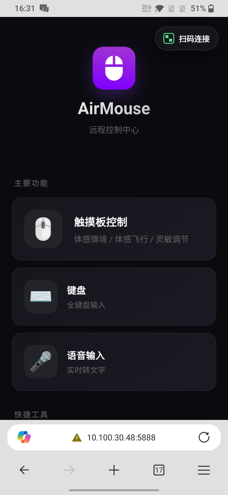
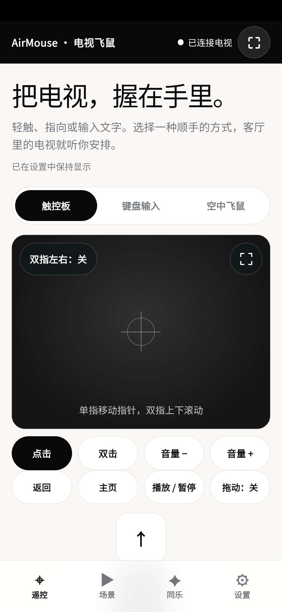
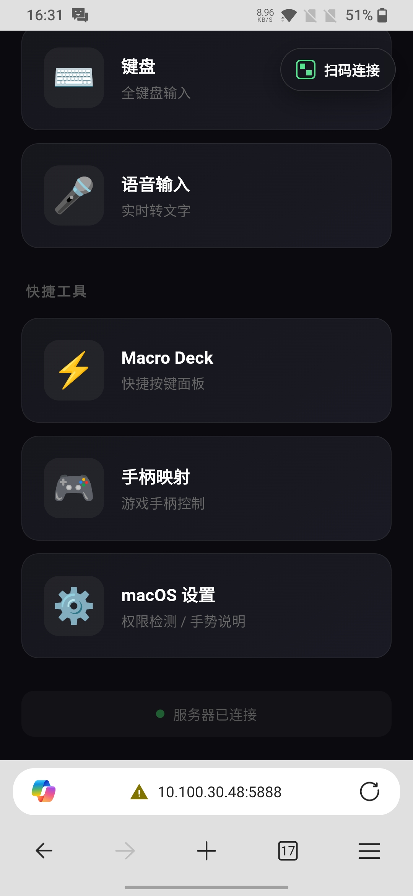
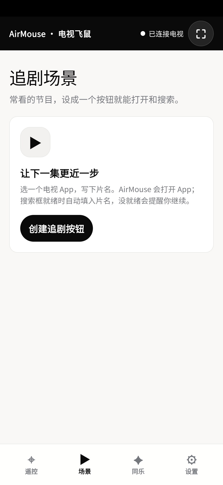

# AirMouse

### 从书桌到沙发，掌控随手可得。

让手机，成为电脑与电视的触控板和键盘。

**手机浏览器即可使用 · 无需安装手机端 App · 同一局域网连接**

[开始使用](#开始使用) · [下载 Android TV 版](https://github.com/qkl9527/AirMouse/releases/latest) · [功能与截图](#功能与截图)


## 一部手机，两种日常

**在书桌前，让操作更随手。** 浏览网页、输入文字、调用常用快捷操作，把身边的手机变成电脑的触控板、键盘和快捷面板。

**在沙发上，让追剧更轻松。** 用手机滑动指针、调节音量，在手机上打好片名再发送到电视搜索框，也可以保存常用的追剧场景。

AirMouse 包含两个独立版本：电脑端接收来自手机浏览器的鼠标和键盘事件；Android TV 端在电视上运行接收 App，再由手机网页控制。使用前，需在目标电脑或电视上运行对应服务，并让手机与目标设备连接同一局域网。

## 功能与截图

| | 电脑端 · Desktop | 电视端 · Android TV |
| :--- | :--- | :--- |
| 日常操控 | 触控板、点击、滚动与拖拽 | 触控板、方向键、返回与主页 |
| 文字输入 | 全键盘与语音输入 | 文字输入、光标移动与搜索 |
| 快捷操作 | Macro Deck 快捷面板、手柄映射 | 音量、播放 / 暂停、自定义快捷键 |
| 更多玩法 | 陀螺仪飞鼠、macOS 手势设置 | 空中飞鼠、追剧场景、最多 4 人抢答与选片投票 |
| 运行环境 | Windows / macOS / Linux | Android TV / Google TV，Android 7.0 及以上 |

<table>
  <tr>
    <th align="center">电脑操控 · 常用工具随手打开</th>
    <th align="center">客厅遥控 · 轻触、输入、选片</th>
  </tr>
  <tr>
    <td align="center"></td>
    <td align="center"></td>
  </tr>
</table>

<details>
<summary>展开更多截图：快捷工具与追剧场景</summary>

<table>
  <tr>
    <th align="center">电脑端 · 快捷工具</th>
    <th align="center">电视端 · 追剧场景</th>
  </tr>
  <tr>
    <td align="center"></td>
    <td align="center"></td>
  </tr>
</table>

完整素材：[电脑端截图](gallery/desktop) · [Android TV 截图](gallery/android-tv)

</details>

## 开始使用

### 控制电脑

先安装 [uv](https://docs.astral.sh/uv/getting-started/installation/)，在本仓库根目录执行：

```bash
cd desktop
uv sync
uv run python server.py
```

让手机与电脑连接同一局域网，在手机浏览器中打开电脑端显示的地址，即可进入控制页面。macOS 使用时需要授予辅助功能权限；默认 HTTPS 使用本地自签证书，浏览器可能提示信任确认。

更多启动方式、手势操作与系统配置，见 [电脑端使用说明](desktop/README.md)。

### 控制电视

**[下载 Android TV 最新正式版](https://github.com/qkl9527/AirMouse/releases/latest)**，在发布页的 Assets 中选择 `.apk` 文件，安装到电视并打开 AirMouse。

1. **开启控制服务。** 点击「开启 AirMouse-电视控制服务」，在电视系统的「无障碍 / 辅助功能」中找到并开启该服务。
2. **设置文字输入。** 点击「设置 AirMouse 输入法」，启用「AirMouse-手机键盘输入」，并将它选为**当前输入法**。这样才能从手机输入文字、移动文字光标和删除字符。
3. **手机扫码连接。** 手机与电视连接同一局域网后，扫描电视 AirMouse 首页的二维码，在手机浏览器中打开遥控页面。
4. **开始操作。** 使用触控板或方向键控制电视；输入片名前，先在电视上选中搜索框等输入位置。

不同电视的设置菜单名称可能不同；若 App 按钮无法打开对应页面，可从电视系统设置中手动进入。

详细操作见 [Android TV 使用说明](android-tv/README.md)。需要自行构建或发布 APK，见 [打包与发布说明](android-tv/RELEASING.md)。

## 使用前了解

- **在同一局域网内使用。** 电视端通过本地网络提供控制服务，不提供互联网远程访问或云端中继。
- **电视 App 的支持情况有所不同。** 部分界面不接受触控手势或文字输入，可改用方向键与确认；文字输入建议启用并选中 AirMouse 输入法。
- **追剧场景需要搜索框就绪。** 场景会检查目标 App 和可编辑焦点；未就绪时会提示继续操作，自动播放也取决于目标 App 的支持情况。
- **空中飞鼠需要额外配置。** 电视端普通触控遥控无需安装证书；首次开启空中飞鼠时，按页面引导完成本地 HTTPS 证书信任。浏览器传感器支持也会影响可用性。

## 项目导航

| 目录 / 文档 | 内容 |
| :--- | :--- |
| [desktop/](desktop/) | Python 电脑端服务与手机网页 |
| [android-tv/](android-tv/) | Kotlin 电视端 App 与手机网页遥控 |
| [gallery/](gallery/) | 应用截图与宣传素材 |
| [超级飞鼠设计说明](docs/superpowers/specs/2026-10-19-android-tv-supermouse-design.md) | Android TV 版本的功能设计 |

## 项目来源与许可

本项目 fork 自 [cornradio/AirMouse](https://github.com/cornradio/AirMouse)。上游原项目是面向 Windows 电脑端的手机鼠标 / 键盘控制方案；本仓库在原电脑版基础上适配支持 macOS，并优化了整体布局和交互，同时新增 Android TV 电视控制服务和手机网页遥控功能。

上游仓库未声明开源许可证。本仓库根目录的 [MIT 许可](LICENSE)仅适用于本 fork 维护者和贡献者原创新增、且有权授权的代码与文档；不涵盖从上游继承的内容，除非相应权利人另行授权。
