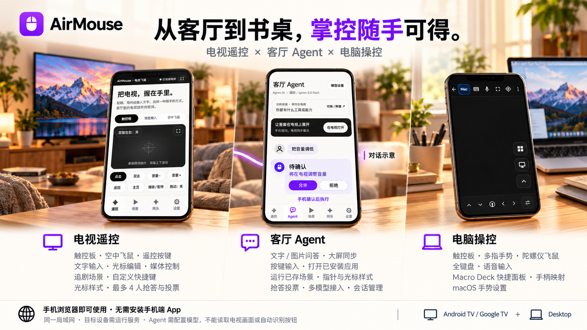
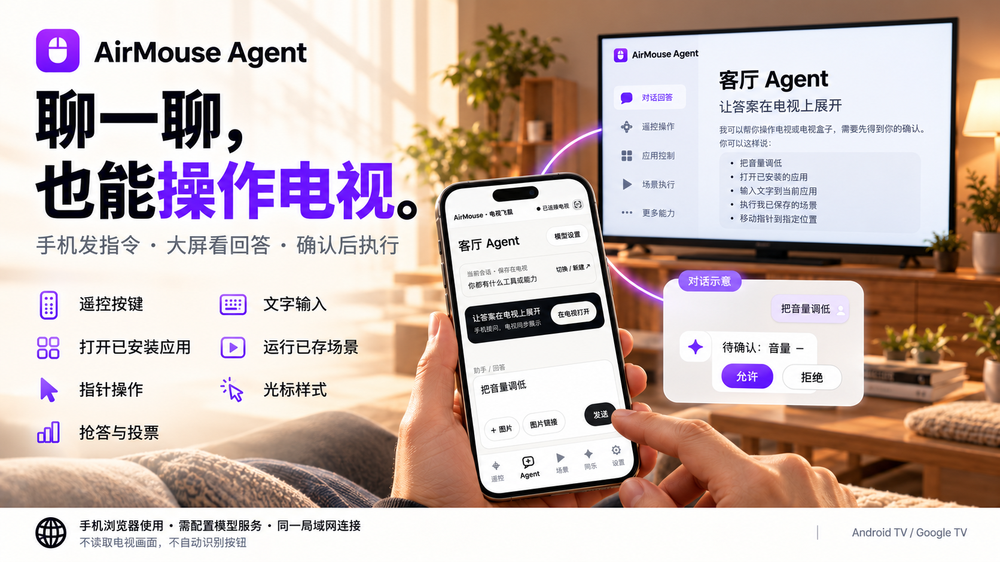
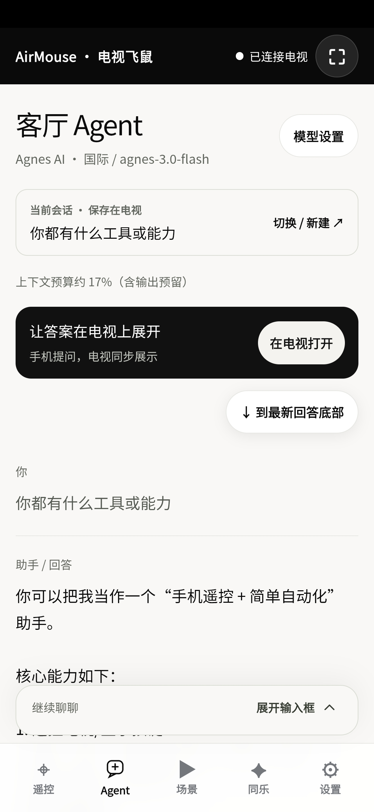
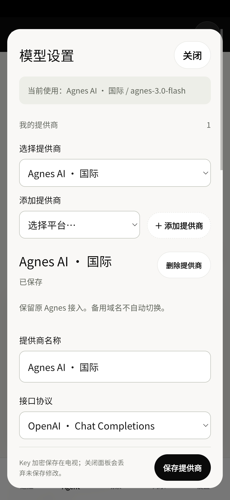

# AirMouse

### 从客厅到书桌，掌控随手可得。

让手机成为电视的遥控器与聊天助手，也成为电脑的触控板和键盘。

**手机浏览器即可使用 · 无需安装手机端 App · 同一局域网连接**

[开始使用](#开始使用) · [客厅 Agent](#客厅-agent聊一聊也能操作电视) · [下载 Android TV 版](https://github.com/qkl9527/AirMouse/releases/latest) · [功能与截图](#功能与截图)



## 一部手机，两种日常

**在沙发上，让电视操作更随手。** 用手机滑动指针、输入片名、调节音量，保存追剧场景，或和朋友一起抢答、投票。进入 **客厅 Agent**，还可以用文字聊天，把按键、输入、开应用等操作交给助手，查看具体步骤并确认后执行，回答也能在电视大屏同步展开。

**在书桌前，让常用工具触手可及。** 浏览网页、输入文字、调用常用快捷操作，把身边的手机变成电脑的触控板、键盘和 Macro Deck 快捷面板。

AirMouse 包含两个独立版本：**Android TV 端**在电视或盒子上运行接收 App，由手机网页遥控、聊天并调用电视操作；**电脑端**接收来自手机浏览器的鼠标和键盘事件。使用前，需在目标设备上运行对应服务，并让手机与目标设备连接同一局域网。Agent 另需配置可用的模型服务。

## 功能与截图

| | 电视端 · Android TV | 电脑端 · Desktop |
| :--- | :--- | :--- |
| 日常操控 | 触控板、方向键、返回、主页与确认 | 触控板、点击、滚动、多指手势与拖拽 |
| 文字输入 | 覆盖 / 插入、光标移动、删除与回车搜索 | 全键盘与语音输入 |
| 快捷操作 | 音量、静音、播放 / 暂停、自定义快捷键 | Macro Deck 快捷面板、手柄映射 |
| 飞鼠与外观 | 空中飞鼠、四种指针样式、灵敏度与触感设置 | 陀螺仪飞鼠、macOS 手势设置 |
| 场景与同乐 | 已保存追剧场景、最多 4 人抢答与选片投票 | — |
| Agent | 文字 / 图片问答、大屏同步、确认后调用七类电视操作 | — |
| 模型与会话 | 多提供商、多模型、流式回答、历史会话与一次性对话 | — |
| 运行环境 | Android TV / Google TV，Android 7.0 及以上 | Windows / macOS / Linux |

<table>
  <tr>
    <th align="center">客厅遥控 · 轻触、输入、选片</th>
    <th align="center">电脑操控 · 常用工具随手打开</th>
  </tr>
  <tr>
    <td align="center"></td>
    <td align="center"></td>
  </tr>
</table>

<details>
<summary>展开更多截图：追剧场景与电脑快捷工具</summary>

<table>
  <tr>
    <th align="center">电视端 · 追剧场景</th>
    <th align="center">电脑端 · 快捷工具</th>
  </tr>
  <tr>
    <td align="center"></td>
    <td align="center"></td>
  </tr>
</table>

完整素材：[Android TV 截图](gallery/android-tv) · [电脑端截图](gallery/desktop)

</details>

## 客厅 Agent：聊一聊，也能操作电视



在手机上输入“把音量调低”“打开已安装的某个应用”或“运行我保存的某个场景”，Agent 会把请求转换成具体操作。**发起对话的手机会列出执行步骤，由你选择允许或拒绝；允许后才执行，并在对话里显示操作结果。**

除了操作电视，还可以多轮聊天、向支持图片的模型发送图片，并将回答同步到电视阅读。支持多提供商与多模型配置、流式输出、历史会话切换和一次性对话；普通会话保存在电视，已配对手机共享当前会话。

### 七类可调用操作

| 能力 | 能做什么 |
| :--- | :--- |
| 遥控按键 | 返回、主页、方向、确认、删除、空格、回车、左右文字光标，以及音量、静音、播放 / 暂停 |
| 文字输入 | 向当前输入框覆盖或插入文字，可随后回车提交，适合搜索、填表与聊天输入 |
| 打开应用 | 按应用名或包名匹配并打开电视上真实安装、可启动的应用 |
| 运行场景 | 执行当前手机浏览器里已有的场景，例如打开应用、输入搜索词、回车与可选播放 |
| 指针操作 | 在当前指针处点击、双击，或按给定增量移动、滚动、拖动 |
| 光标样式 | 切换箭头、薄荷圆环（mint）、晴空方框（blue）、暖阳角标（amber） |
| 聚会互动 | 发起抢答 / 投票、以本手机身份参与抢答 / 投票，或由主持人结束活动 |

**Agent 不会读取电视截图，也不会自动识别屏幕按钮。** 指针操作需要明确的操作参数；输入与搜索需要目标输入框已就绪。它只能打开已安装应用、运行已保存场景，实际执行效果还取决于目标 App 对相关操作的支持。

<details>
<summary>查看 Agent 实际界面与模型设置</summary>

<table>
  <tr>
    <th align="center">客厅 Agent · 手机提问，大屏阅读</th>
    <th align="center">模型设置 · 选择自己的提供商</th>
  </tr>
  <tr>
    <td align="center"></td>
    <td align="center"></td>
  </tr>
</table>

</details>

详细能力、模型配置、会话与执行约束见 [Agent 使用说明](android-tv/AGENT.md)。

## 开始使用

### 控制电视

**[下载 Android TV 最新正式版](https://github.com/qkl9527/AirMouse/releases/latest)**，在发布页的 Assets 中选择 `.apk` 文件，安装到电视并打开 AirMouse。体验 Agent 时，请确认安装版本包含该功能；也可按 [Android TV 使用说明](android-tv/README.md)从当前源码构建。

1. **开启控制服务。** 点击「开启 AirMouse-电视控制服务」，在电视系统的「无障碍 / 辅助功能」中找到并开启该服务。
2. **设置文字输入。** 点击「设置 AirMouse 输入法」，启用「AirMouse-手机键盘输入」，并将它选为**当前输入法**，用于向电视 App 输入文字、移动文字光标和删除字符。
3. **手机扫码连接。** 手机与电视连接同一局域网后，扫描电视 AirMouse 首页的二维码，在手机浏览器中打开控制页面。
4. **开始操作。** 使用触控板或方向键控制电视；输入片名前，先在电视上选中搜索框等输入位置。底部还可进入 Agent、场景、同乐和设置。

不同电视的设置菜单名称可能不同；若 App 按钮无法打开对应页面，可从电视系统设置中手动进入。

详细操作见 [Android TV 使用说明](android-tv/README.md)。需要自行构建或发布 APK，见 [打包与发布说明](android-tv/RELEASING.md)。

### 启用电视 Agent

1. **配置模型。** 手机进入 **Agent → 模型设置**，添加提供商并填写对应 API Key，读取或手动添加模型，再选择 **保存并设为当前模型**。调用电视操作需选择支持工具调用的模型，并启用工具能力。
2. **在大屏阅读。** 点击 **在电视打开**，进入电视 Agent 阅读页；手机发送问题后，回复同步显示在手机与电视上。
3. **聊天或请求操作。** 输入问题，或发送“把音量调低”等请求。向电视 App 输入文字前，仍需让目标输入框就绪。
4. **查看并确认。** 手机弹出具体步骤后，选择 **允许**执行，或 **拒绝**继续聊天。新的操作请求仍需确认。

支持国内外主流提供商、OpenRouter 等聚合平台与自定义服务；提供商、Key 和模型配置加密保存在电视，已配对手机同步配置但不获取 Key 原文。电视需要能够访问所选模型服务。图片问答需选择支持图片的模型并启用图片能力；Agent 聊天本身不依赖 AirMouse 输入法。

详细平台与参数见 [Agent 使用说明](android-tv/AGENT.md)。

### 控制电脑

先安装 [uv](https://docs.astral.sh/uv/getting-started/installation/)，在本仓库根目录执行：

```bash
cd desktop
uv sync
uv run python server.py
```

让手机与电脑连接同一局域网，在手机浏览器中打开电脑端显示的地址，即可进入控制页面。macOS 使用时需要授予辅助功能权限；默认 HTTPS 使用本地自签证书，浏览器可能提示信任确认。

更多启动方式、手势操作与系统配置，见 [电脑端使用说明](desktop/README.md)。

## 使用前了解

- **设备控制在同一局域网内进行。** 电视端不提供互联网远程访问或云端中继；Agent 的模型请求由电视通过 HTTPS 发送到配置的模型服务。
- **电视 App 的支持情况有所不同。** 部分界面不接受触控手势或文字输入，可改用方向键与确认；文字输入建议启用并选中 AirMouse 输入法。
- **追剧场景需要搜索框就绪。** 场景会检查目标 App 和可编辑焦点；未就绪时会提示继续操作，自动播放也取决于目标 App 的支持情况。
- **Agent 操作需确认，且没有电视画面识别能力。** 多步操作失败后会停止后续步骤，已完成步骤不会自动回滚；“在电视打开”用于进入阅读页，不能远程开机。
- **空中飞鼠需要额外配置。** 电视端普通触控遥控无需安装证书；首次开启空中飞鼠时，按页面引导完成本地 HTTPS 证书信任。浏览器传感器支持也会影响可用性。

## 项目导航

| 目录 / 文档 | 内容 |
| :--- | :--- |
| [android-tv/](android-tv/) | Kotlin 电视端 App、手机网页遥控与客厅 Agent |
| [Agent 使用说明](android-tv/AGENT.md) | 七类工具、模型配置、会话与执行流程 |
| [desktop/](desktop/) | Python 电脑端服务与手机网页 |
| [gallery/](gallery/) | 应用截图与宣传素材 |
| [超级飞鼠设计说明](docs/superpowers/specs/2026-10-19-android-tv-supermouse-design.md) | Android TV 版本的功能设计 |

## 项目来源与许可

本项目 fork 自 [cornradio/AirMouse](https://github.com/cornradio/AirMouse)。上游原项目是面向 Windows 电脑端的手机鼠标 / 键盘控制方案；本仓库在原电脑版基础上适配支持 macOS，并优化了整体布局和交互，同时新增 Android TV 电视控制服务、手机网页遥控和客厅 Agent 功能。

上游仓库未声明开源许可证。本仓库根目录的 [MIT 许可](LICENSE)仅适用于本 fork 维护者和贡献者原创新增、且有权授权的代码与文档；不涵盖从上游继承的内容，除非相应权利人另行授权。
